# VisaVoyage AI — Architectural Differentiation & Boundary Guide

This document establishes the **absolute architectural isolation** between the **Frontend (Client)**, the **Backend (Server)**, the **AI Engine (Google GenAI)**, and the **Database (Supabase PostgreSQL)**.

---

## 🏛️ Layer-by-Layer Architectural Separation

```mermaid
graph LR
    subgraph ClientLayer["🖥️ Frontend Tier (frontend/) - Port 5173"]
        ReactUI["React 18 + Vite UI"]
        AuthContext["Supabase GoTrue Auth Context"]
        AxiosClient["Axios REST Client"]
    end

    subgraph SecurityBoundary["🛡️ Security Boundary (HTTP REST / TLS)"]
        BearerToken["Authorization: Bearer <Supabase_JWT>"]
    end

    subgraph ServerLayer["⚙️ Backend Tier (backend/) - Port 5000"]
        ExpressApp["Express.js App + Helmet + RateLimit"]
        AuthMiddleware["requireAuth Middleware"]
        ZodValidator["Zod Input Validation"]
        AIController["AI Orchestration Controller"]
    end

    subgraph ExternalServices["☁️ Cloud & Persistence Services"]
        GeminiAI["Google GenAI (gemini-2.5-flash)"]
        SupabaseDB["Supabase PostgreSQL (RLS: auth.uid = user_id)"]
    end

    ReactUI --> AuthContext
    AuthContext --> AxiosClient
    AxiosClient -- "REST Requests + JWT" --> SecurityBoundary
    SecurityBoundary --> ExpressApp
    ExpressApp --> AuthMiddleware
    AuthMiddleware --> ZodValidator
    ZodValidator --> AIController
    AIController -- "Private API Key" --> GeminiAI
    AIController -- "Verified UID Persistence" --> SupabaseDB
```



---

## 📊 Comparison Matrix: Frontend vs. Backend

| Attribute | 🖥️ Frontend (`frontend/`) | ⚙️ Backend (`backend/`) |
| :--- | :--- | :--- |
| **Execution Environment** | Web Browser (Client-side JavaScript) | Node.js Runtime (ESM) |
| **Primary Host/Port** | `http://localhost:5173` (Vite dev server) | `http://localhost:5000` (Express server) |
| **Core Frameworks** | React 18, React Router DOM, Tailwind CSS | Express.js, TypeScript |
| **Primary Responsibility** | User experience, reactive UI, forms, rendering | Business logic, token validation, AI calls, DB writes |
| **Authentication Role** | Initiates login/signup; holds short-lived session JWT | Verifies JWT on protected routes via `requireAuth` |
| **Google GenAI Access** | ❌ **PROHIBITED** (Zero Gemini API keys allowed) | ✅ **EXCLUSIVE** (`@google/genai` instantiated here) |
| **Database Access** | ⚠️ Public client only (`anon` key for auth) | ✅ Privileged client (`service_role` or user context) |
| **Input Validation** | Client-side form feedback | Strict server-side Zod schema enforcement |
| **File Handling** | Browser file selector / Drag & Drop preview | Multer memory storage & Buffer streaming |
| **Security Controls** | Route guards (`<ProtectedRoute />`), HTTPS | Helmet headers, CORS policies, Express rate limiting |

---

## 🔐 The Security Boundary Contract

1. **Client Isolation**:
   - The browser client only knows the public `VITE_SUPABASE_URL` and `VITE_SUPABASE_ANON_KEY`.
   - The secret `GEMINI_API_KEY` and `SUPABASE_SERVICE_ROLE_KEY` reside strictly in `backend/.env` and are never exposed to the client.

2. **Authenticated Request Lifecycle**:
   - The user authenticates with Supabase Auth on the client, yielding a JSON Web Token (JWT).
   - Every protected API request includes the header:
     ```http
     Authorization: Bearer <SUPABASE_JWT>
     ```
   - The Express middleware `requireAuth` intercepts the request:
     - Parses the Bearer token.
     - Calls `supabaseAdmin.auth.getUser(token)` to verify cryptographic signature and expiration.
     - Attaches the verified user profile to `req.user = { id: user.id, email: user.email }`.

3. **Data Isolation (PostgreSQL Row-Level Security)**:
   - When storing itineraries (`public.travel_itineraries`) or visa inquiries (`public.visa_checks`), the backend associates each record with `req.user.id`.
   - PostgreSQL policies (`USING (auth.uid() = user_id)`) guarantee that users cannot read or modify records belonging to other travelers.

---

## 📁 Monorepo Directory Boundary Map

```
foregin journey advisor/
├── frontend/                   # [FRONTEND ONLY - PORT 5173]
│   ├── src/components/         # Reusable UI cards, forms, badges
│   ├── src/pages/              # Page views (Landing, Dashboard, Itinerary, etc.)
│   ├── src/schemas/            # Frontend-specific validation schemas
│   ├── src/context/            # Client auth state & session handling
│   ├── src/lib/api.ts          # Axios client (calls server on port 5000)
│   └── src/lib/supabase.ts     # Client Supabase instance
│
├── backend/                    # [BACKEND ONLY - PORT 5000]
│   ├── src/controllers/        # Business logic & AI controller
│   ├── src/middleware/         # JWT verification (requireAuth) & errors
│   ├── src/schemas/            # Backend-specific validation schemas
│   ├── src/routes/             # Express API endpoints (/api/ai, /api/itineraries)
│   ├── src/services/           # Google GenAI service & Supabase DB service
│   └── src/index.ts            # Server entrypoint with Helmet & Rate limiting
│
├── start-frontend.bat          # 1-Click Frontend Runner
├── start-backend.bat           # 1-Click Backend Runner
└── supabase-schema.sql         # PostgreSQL schema & Row-Level Security policies
```
